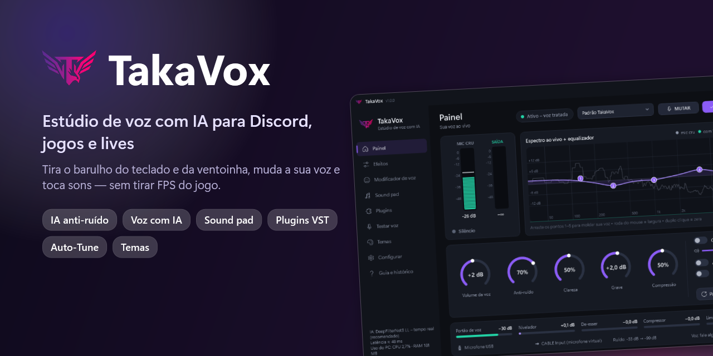
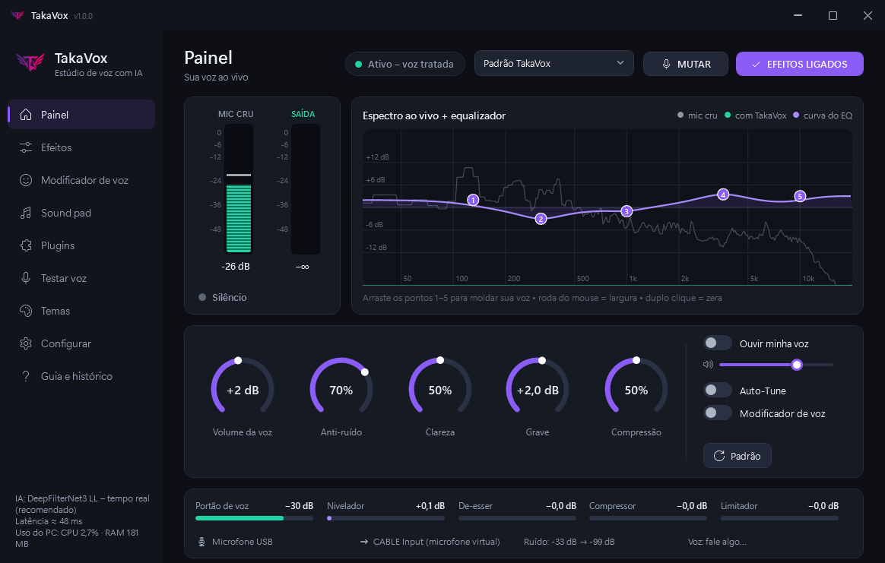
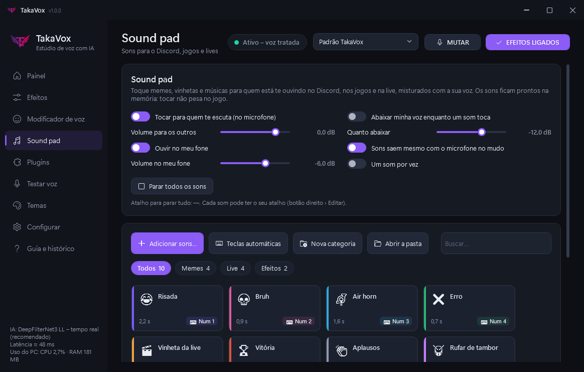
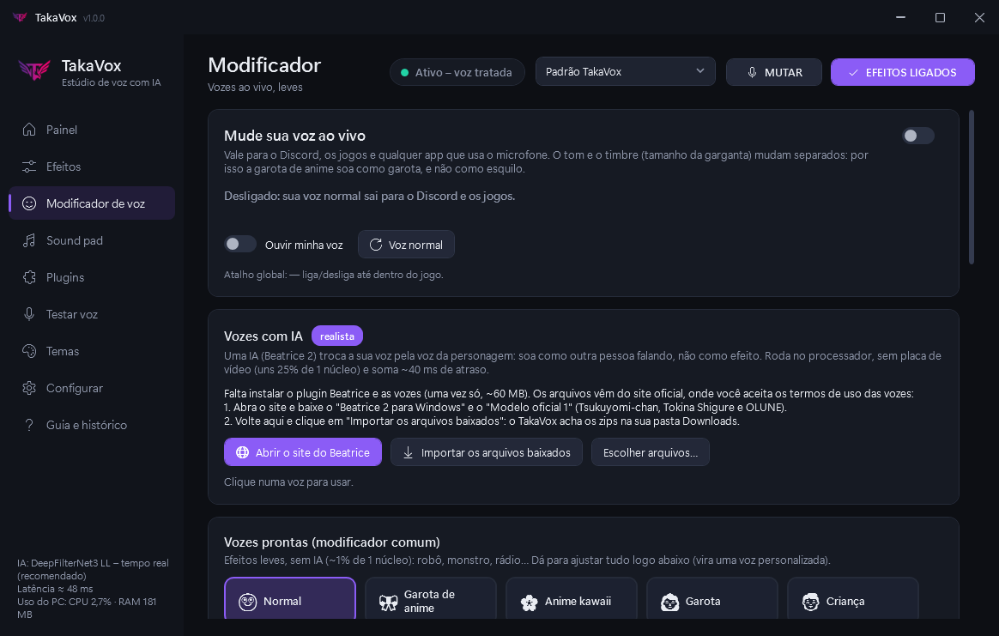
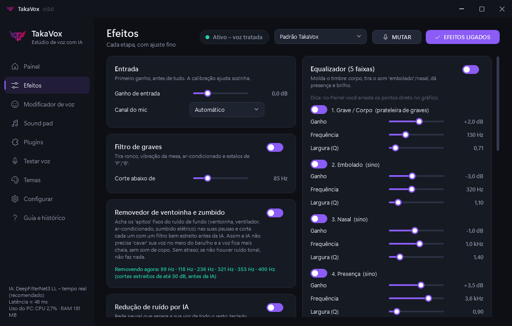
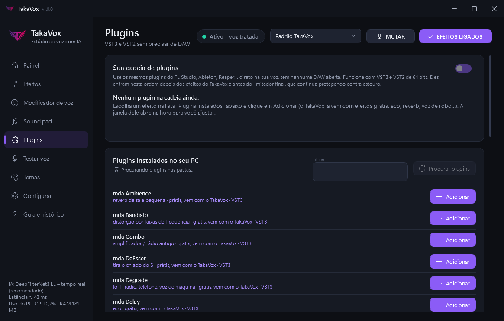
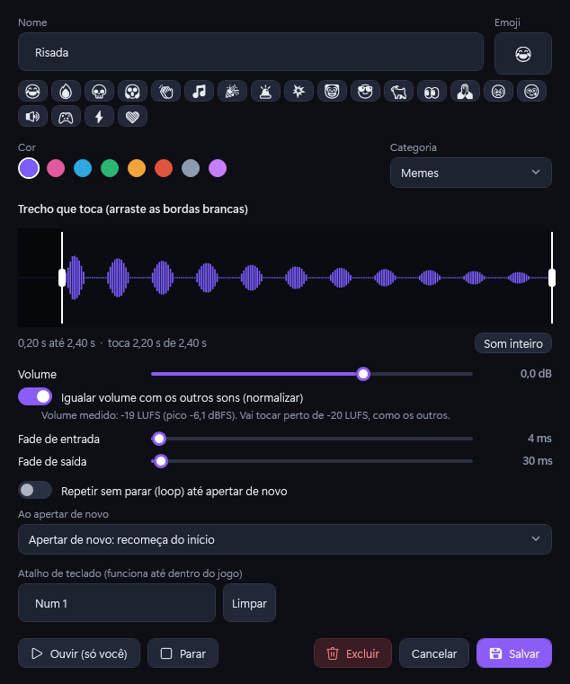
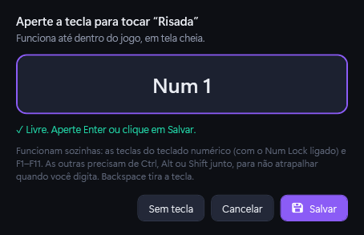
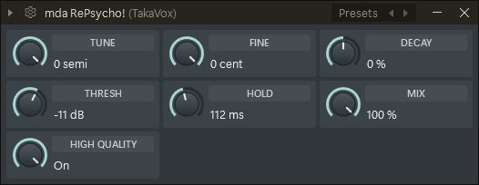
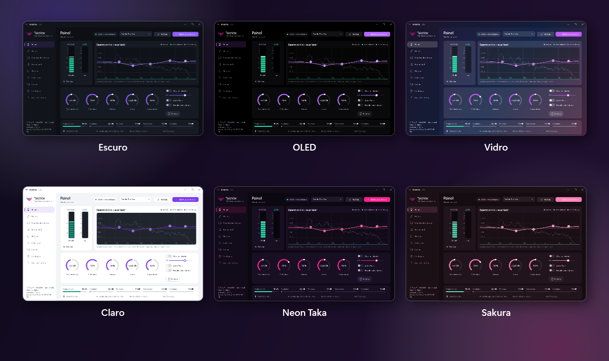

<p align="center">
  
</p>

<p align="center">
  <a href="../../releases/latest"></a>
  <a href="https://takad3v.github.io/TakaVox/"></a>
</p>

<p align="center">
  
  
  
  
  
</p>

**TakaVox** deixa a sua voz com som de estúdio no **Discord, nos jogos e na live**:

- tira o barulho de teclado, mouse e ventoinha com IA;
- muda a sua voz, inclusive com IA realista;
- toca sons com teclas de atalho;
- roda plugins VST sem DAW nenhuma.

Tudo isso sem tirar FPS do jogo. É grátis e de código aberto.

<p align="center">
  
</p>

## O que ele faz

| | |
|---|---|
| 🎙️ **Voz limpa com IA** | A IA DeepFilterNet3 tira teclado mecânico, cliques de mouse, ventoinha, rua e chiado sem deixar a voz robótica. Um removedor de ventoinha e zumbido acha os "apitos" do seu PC e corta cada um. |
| 🎚️ **Som de estúdio** | Portão de voz guiado pela IA, nivelador automático, equalizador de 5 faixas (arraste os pontos), de-esser, compressor e limitador: a voz nunca estoura. A **calibração automática** de 10 s acerta tudo para o seu mic. |
| 🎭 **Modificador de voz** | 22 vozes prontas (garota de anime, robô, monstro, demônio, rádio…), com tom e timbre separados. Também tem **vozes com IA** realistas (Beatrice 2) que soam como outra pessoa falando. |
| 🔊 **Sound pad** | Memes, vinhetas e músicas com **tecla de atalho** que funciona até dentro do jogo. Os sons tocam no mesmo volume, com trecho, fade e loop, e dá para abaixar a sua voz enquanto um som toca. |
| 🎛️ **Plugins VST3 e VST2** | Os mesmos do FL Studio, Ableton e Reaper, direto na voz e sem DAW, numa janela no estilo do FL Studio. Já vem com ~20 efeitos grátis. |
| 🎵 **Auto-Tune** | Em tempo real, do efeito robô (T-Pain) até uma correção natural. |
| 🎨 **Temas** | Escuro, OLED, Vidro (estilo iOS, com o desfoque do Windows 11), Claro, Neon, Grafite, Oceano e Sakura. |
| 🎮 **Feito para jogar e para live** | Economia automática, 0% de CPU na bandeja e áudio no núcleo que os jogos menos usam. |

## Telas

<table>
  <tr>
    <td width="50%"><br><b>Sound pad</b>: pads com emoji, cor, categorias e a tecla de cada som.</td>
    <td width="50%"><br><b>Modificador de voz</b>: vozes com IA e 22 vozes prontas.</td>
  </tr>
  <tr>
    <td><br><b>Efeitos</b>: cada etapa da cadeia de estúdio, com ajuste fino.</td>
    <td><br><b>Plugins</b>: VST3/VST2 na sua voz, sem DAW.</td>
  </tr>
  <tr>
    <td><br><b>Editor de som</b>: trecho (forma de onda), volume em LUFS, fades, loop e atalho.</td>
    <td><br><b>Tecla em 1 clique</b>: clique no ⌨ do pad e aperte a tecla.<br><br><br><b>Janela de plugin no estilo do FL Studio</b>.</td>
  </tr>
</table>

<p align="center">
  
</p>

## Instalar

1. Baixe o **`TakaVox-Setup-1.0.0.exe`** em [Releases](../../releases/latest).
2. Execute. Ele instala só para o seu usuário e não pede administrador.
   - O Windows pode mostrar "O Windows protegeu o computador", porque o app ainda não tem certificado pago. Clique em **Mais informações › Executar assim mesmo**.
3. No primeiro uso, o app guia você:
   - **Instalar o microfone virtual** (1 clique): o TakaVox baixa o VB-CABLE oficial do site da VB-Audio, confere a assinatura digital e abre o instalador deles.
   - **Calibrar** (10 s): fique 3 s em silêncio e depois fale normalmente.
4. No **Discord** (Configurações › Voz e vídeo):
   - dispositivo de entrada: **Padrão** (ou "CABLE Output");
   - **Supressão de ruído: Nenhuma** (o Krisp corta música, sons e efeitos; o TakaVox já limpa a voz);
   - controle automático de ganho: desligado.
5. Nos **jogos** (Valorant, CS2, Fortnite…), deixe o microfone no padrão do Windows. No **OBS**, adicione o "CABLE Output" como fonte de áudio do microfone.

O instalador já traz tudo, inclusive as IAs anti-ruído. Só a **voz com IA** é à parte (veja abaixo).

### Voz com IA (opcional)

As vozes com IA usam o [Beatrice 2](https://prj-beatrice.com/), um conversor de voz gratuito do Project Beatrice. O TakaVox não pode trazer o plugin e as vozes junto, porque os termos não permitem redistribuir, então você baixa no site oficial:

1. Em **Modificador de voz › Vozes com IA**, clique em **Abrir o site do Beatrice**.
2. Baixe o **Beatrice 2 para Windows** e o **Modelo oficial 1**, aceitando os termos de uso das vozes.
3. Volte e clique em **Importar os arquivos baixados**. O TakaVox acha os zips na pasta Downloads.

Detalhes da voz com IA:
- **Vozes:** Tsukuyomi-chan (garota de anime), Tokina Shigure e OLUNE, mais 100 vozes do corpus JVS (só para uso não comercial).
- **Tom automático:** o app mede o tom médio da sua voz e acerta o tom da personagem sozinho.
- **Peso:** roda no processador, sem placa de vídeo, e soma ~47 ms de atraso.

## Atalhos

Os atalhos funcionam até dentro do jogo, em tela cheia.

| Atalho | O que faz |
|---|---|
| `Ctrl+Alt+M` | Mudo (se outro programa já usa, vira `Ctrl+Alt+Shift+M`) |
| `Ctrl+Alt+V` | Liga/desliga o modificador de voz |
| `Ctrl+Alt+T` | Liga/desliga o Auto-Tune |
| `Ctrl+Alt+B` | Liga/desliga todos os efeitos (antes × depois) |
| `Ctrl+Alt+P` | Para todos os sons do sound pad |
| A sua escolha | Cada som do sound pad: clique no **⌨** do pad e aperte a tecla. O teclado numérico e F1–F11 funcionam sozinhos; **Teclas automáticas** coloca Num 1…Num 0 de uma vez. |

## Feito para jogar e para live

Medido num Ryzen 5 5500 com o app na bandeja.

**Economia automática.** Quando nenhum app (Discord, jogo, OBS) está usando o microfone virtual e a janela está fechada, ninguém está te ouvindo. A IA para e o TakaVox usa **0,4% de um núcleo**. O Windows avisa na hora em que um app abre o microfone, e ele volta antes da primeira palavra: aquece a IA com os últimos 60 ms de áudio.

**Em uso**, com a IA anti-ruído ligada, ele usa ~15–25% de um núcleo (~2% do processador). Esse é o custo de tirar o ruído com qualidade.

**Na bandeja:**
- a interface fica parada (0% de CPU);
- a memória da tela volta para o Windows: **~230 MB → ~60 MB** em uso.

**Áudio sem estalo:**
- as threads de áudio preferem o último núcleo do processador, o que os jogos menos usam;
- a voz com IA roda numa thread própria, com folga, então um pico de CPU não vira estalo;
- se a IA falhar, a sua voz normal volta sozinha: o microfone nunca fica mudo.

**Leve no resto:**
- nada é desenhado com um jogo em tela cheia na frente;
- o sound pad usa menos de 0,5% de um núcleo com 32 sons tocando e não aloca memória durante o jogo.

## Perguntas frequentes

**Tira FPS?**
Na prática, não. Sem ninguém te ouvindo, ele descansa. Em call, usa ~2% do processador, longe dos núcleos que o jogo mais usa.

**Funciona no Valorant / com anti-cheat?**
Sim. O TakaVox é um app de áudio comum: não injeta nada no jogo e usa os atalhos normais do Windows.

**Os sons do sound pad cortam no Discord.**
Desligue a **Supressão de ruído (Krisp)** do Discord. Ela trata música e efeitos como ruído.

**Como volto tudo como era antes?**
Em **Configurar › Restaurar tudo como era antes** (microfone padrão, volume do mic e inicialização). Para desinstalar, use "Aplicativos instalados" do Windows.

**Onde ficam os meus dados?**
Em `%APPDATA%\TakaVox`: ajustes, vozes salvas, sound pad (`sons`), presets de plugins e a voz com IA (`ia`).

## Compilar do código

Requisitos:
- Windows 10/11 x64;
- [Visual Studio Build Tools](https://visualstudio.microsoft.com/visual-cpp-build-tools/), com C# e C++;
- [Rust](https://rustup.rs), só para recompilar a IA.

```powershell
powershell -ExecutionPolicy Bypass -File native\get_deepfilternet.ps1   # baixa o código do DeepFilterNet 0.5.6
powershell -ExecutionPolicy Bypass -File native\get_vst3sdk.ps1          # baixa o VST 3 SDK 3.8.1 (hospedeiro de plugins)
powershell -ExecutionPolicy Bypass -File build.ps1                       # app + IA + instalador em build\
```

| Pasta | Conteúdo |
|---|---|
| `src/Audio` | Captura e saída WASAPI, fila elástica com correção de relógio, dispositivos, sound pad (mixer, biblioteca, arquivos) e economia automática |
| `src/Dsp` | Cadeia de voz: IA, portão, motor de tom (YIN + PSOLA com formantes), efeitos do modificador, EQ, compressor, limitador |
| `src/Plugins` | Cadeia de plugins VST na thread de áudio, biblioteca, leitor em processo separado, voz com IA (Beatrice) |
| `src/UI` | Interface WPF: temas, medidores, espectro com EQ arrastável, sound pad, janela de plugin no estilo do FL Studio |
| `native/tvhost` | `tvhost.dll` em C++: hospedeiro VST3 (SDK oficial) e VST2, janela embutida, presets, e arquivos de áudio pelo Media Foundation |
| `native/takavox_df` | DLL em Rust que expõe a DeepFilterNet3 (modelos embutidos) |
| `native/rnnoise-0.2` | RNNoise (IA leve, alternativa) |
| `assets/`, `docs/` | Arte dos ícones, banner e capturas |
| `tools/` | Instalador, gerador de ícone e testes (qualidade da voz, plugins, voz com IA, sound pad, mistura final, desempenho) |

## Créditos e licenças

- **TakaVox**: licença MIT (veja [`LICENSE`](LICENSE)).
- [DeepFilterNet](https://github.com/Rikorose/DeepFilterNet), de Hendrik Schröter: MIT / Apache-2.0.
- [RNNoise](https://github.com/xiph/rnnoise), da Xiph.Org: BSD-3-Clause.
- [VST 3 SDK](https://github.com/steinbergmedia/vst3sdk), da Steinberg: MIT. VST é marca registrada da Steinberg Media Technologies GmbH.
- Efeitos mda (Paul Kellett), na versão VST3 dos exemplos do SDK: MIT.
- [VB-CABLE](https://vb-audio.com/Cable/), da VB-Audio Software: donationware, **não incluído**. O app baixa o pacote oficial. Se puder, apoie o autor.
- [Beatrice 2](https://prj-beatrice.com/), do Project Beatrice: **não incluído**, o usuário baixa no site oficial. As vozes têm termos próprios: Tsukuyomi-chan © Rei Yumesaki; 刻鳴時雨, de 瓶詰め; OLUNE, de Leo Carvalho; JVS só para uso não comercial.

Detalhes em [THIRD_PARTY_NOTICES.md](THIRD_PARTY_NOTICES.md). Novidades de cada versão em [CHANGELOG.md](CHANGELOG.md).
